# PID genérico en C — versión mejorada

Este repositorio contiene la **versión mejorada** de mi controlador PID genérico en C (`pid.c` / `pid.h`). Sigue siendo portable, sin `malloc`, sin variables globales y sin más dependencia que `<stdint.h>`.

La primera versión, junto con el informe técnico y la simulación original, está en otro repositorio: <https://github.com/HernandezMatiasDev/PID>. Acá no está el código viejo; cuando lo comparo, lo hago con fragmentos de esa versión para que se entienda qué cambió y por qué.

> Las capturas son de mi simulador (**PID Control Lab**, un dron de una dimensión). El PID que corre ahí es este mismo código compilado como biblioteca compartida. El simulador solo implementa la física y los gráficos.

---

## Índice

1. [Mejoras generales: firmas y contratos](#1-mejoras-generales-firmas-y-contratos)
2. [Comentarios: de buena práctica a necesidad](#2-comentarios-de-buena-práctica-a-necesidad)
3. [Idea central: cada mejora es un modificador de curva](#3-idea-central-cada-mejora-es-un-modificador-de-curva)
4. [Feedforward](#4-feedforward)
5. [Término proporcional: rampa y pasa-bajos](#5-término-proporcional-rampa-y-pasa-bajos)
6. [Término derivativo: corrección de errores](#6-término-derivativo-corrección-de-errores)
7. [Término integral: anti-windup](#7-término-integral-anti-windup)
8. [Costo en RAM](#8-costo-en-ram)
9. [Uso básico](#9-uso-básico)
10. [Diferencias con el simulador anterior](#10-diferencias-con-el-simulador-anterior)
11. [Notas y limitaciones](#11-notas-y-limitaciones)
---

## 1. Mejoras generales: firmas y contratos

Lo primero que cambió es la **forma de usar** el controlador. Hay más funciones, cada una con sus validaciones, y los datos se pueden modificar de a uno o todos juntos.

### 1.1 Firmas

| Función | Versión anterior | Esta versión |
|---|---|---|
| `PID_Init` | `kp, ki, kd, k_deriv_filter, out_max, out_min, int32_t deadband` | `kp, ki, kd, Tt, rate, tf_filter, k_deriv_filter, out_max, out_min, float deadband` |
| `PID_Compute` | `(pid, posición, dt)` | `(pid, posición, dt, Feedforward)` |
| `PID_SetGains` | `kp, ki, kd, k_deriv_filter` | `kp, ki, kd, Tt, rate, tf_filter, k_deriv_filter` |
| `PID_SetOutputLimits` | `out_max, out_min, deadband` | `out_max, out_min` (la zona muerta ahora tiene su propio setter) |
| `PID_SetIntegral` | `PID_SetIntegralSum` | (la funcion PID_SetIntegralSum ahora se llama PID_SetIntegral) |
| Setters individuales | no existían | `SetKp`, `SetKi`, `SetKd`, `SetTt`, `SetDerivFilter`, `SetDeadband`, `SetRate`, `SetTfFilter` |

`PID_SetTarget`, `PID_Reset` y `PID_SetIntegral` siguen existiendo, pero su comportamiento interno cambió (más abajo).

### 1.2 Modificar todo junto o por separado

- **Todo junto:** `PID_Init` y `PID_SetGains` sirven para cargar una configuración completa (por ejemplo, un preset).
- **Por separado:** cada parámetro tiene su setter. Sirve para ajustar *en vivo* una sola cosa, como un slider de una interfaz, sin tocar el resto ni el estado del controlador.
- **Una sola fuente de validación:** `PID_SetGains` no escribe los campos directamente, sino que llama a los setters individuales. Así las reglas de cada parámetro están escritas una sola vez y se cumplen sin importar por dónde entre el valor.

### 1.3 Validaciones

| Setter | Qué valida o hace |
|---|---|
| `PID_SetOutputLimits` | Si `out_min > out_max`, los **intercambia**. |
| `PID_SetDeadband` | Un valor negativo no tiene sentido: lo lleva a `0`. |
| `PID_SetRate` | Negativo → `0` (sin rampa). |
| `PID_SetTfFilter` | Negativo → `0` (sin filtro del objetivo). |
| `PID_SetDerivFilter` | Negativo → `0` (sin filtro de la derivada). Un valor negativo podía terminar en una división por cero. |
| `PID_SetKi` | Si `ki == 0` **borra la integral** y recalcula `kb`. |
| `PID_SetTt` | Guarda `Tt` y recalcula `kb`. |

**`kb`** es una variable calculada internamente a partir de `kb = 1/Tt` se calcula en un único lugar, `pid_update_kb()`, y queda en `0` si `ki == 0` **o** `Tt <= 0`. Hay dos razones:

1. Evito una división por cero.
2. `kb = 0` es exactamente "anti-windup apagado", así que en `PID_Compute` no necesito ningún `if` para ese caso. Cualquier setter que cambie `ki` o `Tt` la recalcula (`SetKi`, `SetTt`, y por lo tanto `SetGains`).

**`PID_Init` pone `ki = 0` y `Tt = 0` antes de llamar a `PID_SetGains`.** `pid_update_kb()` lee `ki` y `Tt`, y en ese momento la estructura todavía puede tener basura de memoria. Poniéndolas en cero primero, el cálculo es seguro. Después los setters cargan los valores reales.

### 1.4 Contratos que cambiaron

Estos cambios rompen la compatibilidad con la versión anterior:

- **La integral ahora está en unidades de salida.** Antes `PID_SetIntegralSum` guardaba `∫e dt` y la salida era `ki * integral_sum`. Ahora `integral` guarda directamente `Ki·∫e dt`. Por eso `PID_SetIntegral` recibe un valor en **unidades de salida**, no en "error × segundos".
  Una consecuencia buena es que cambiar `Ki` en caliente ya no produce un salto en la salida. Antes, al mover `ki`, toda la integral acumulada se reescalaba de golpe. Ahora lo acumulado queda como está y el nuevo `Ki` solo afecta lo que se acumule desde ese momento.
- **`k_deriv_filter` cambió de significado.** Antes era un coeficiente adimensional (`1` = sin filtro). Ahora es una **constante de tiempo en segundos** (`0` = sin filtro). Para migrar un valor viejo `α` a un `dt` típico: `τ = dt·(1 − α)/α`.
- **`deadband` pasó de `int32_t` a `float`**, y ya no se configura junto con los límites de salida.
- **`PID_Compute` recibe el `Feedforward`** (sección 4).
- **`PID_Reset` y el estado `initialized`.** Un flag, `initialized`, vale `1` al inicio y después de cada `PID_Reset`. El siguiente `PID_Compute` lo ve y arranca la rampa, el filtro y la posición previa **desde la posición actual**. Así no hay saltos ni picos en el primer ciclo ni después de un reset. En la versión anterior, `previous_error` arrancaba en `0`, y el primer ciclo producía un pico en la derivada si el error no era cero.
- **`PID_SetTarget` ya no es solo una asignación.** Además de guardar el objetivo, corrige los offsets de la rampa y del filtro para que el setpoint efectivo no pegue un salto (sección 5.4).

---

## 2. Comentarios: de buena práctica a necesidad

Ahora **todas las variables del `struct` y todas las funciones están comentadas**, tanto en el `.h` como en el `.c`.

Esto empezó por una necesidad mía. Al sumar `Tt`, `kb`, la rampa, el filtro, los offsets, el flag `initialized` y demás, me empecé a perder con mis propias variables: ya no tenía claro cuál era configuración, cuál era estado, en qué unidades estaba cada una y qué término afectaba. Primero comenté lo que necesitaba para no perder el hilo y, una vez que lo hice, seguí y comenté todas las variables y todas las funciones. Así que los comentarios fueron primero una **necesidad** y recién después una buena práctica.

Ahora el `struct` se lee de arriba abajo con su significado, su unidad y qué valor lo desactiva (por ejemplo, `Tt`: *"0 = sin anti-windup"*).

---

## 3. Idea central: cada mejora es un modificador de curva

Para decidir qué mejoras hacer, pensé en cada una como **un método que modifica una curva de una manera distinta**:

| Mejora | Qué curva modifica |
|---|---|
| Rampa | La referencia (el objetivo) que ve el término P y el I |
| Pasa-bajos del objetivo | La referencia, suavizándole las esquinas |
| Filtro de la derivada | La señal de velocidad que ve el término D |
| Anti-windup (`Tt`) | La curva de acumulación de la integral |
| Feedforward | La salida, sumándole un empuje conocido de antemano |

Se pueden **combinar** para lograr el movimiento que cada aplicación necesita. Y **si pongo un parámetro en 0, esa mejora deja de tener efecto**. Eso es lo que lo mantiene *genérico*: con todo en 0 queda un PID clásico, y cada mejora se activa solo si la necesito.

| Parámetro | En `0` |
|---|---|
| `kp` | Sin acción proporcional |
| `ki` | Sin integral (y sin anti-windup) |
| `kd` | Sin derivada |
| `Tt` | Sin anti-windup (el límite duro de la integral sigue activo) |
| `rate` | Sin rampa: el objetivo salta de golpe |
| `tf_filter` | Sin filtro del objetivo |
| `k_deriv_filter` | Sin filtro de la derivada |
| `deadband` | Sin zona muerta |
| `Feedforward` | Sin empuje extra |

Cada mejora trae sus variables nuevas, que explico en su sección.

---

## 4. Feedforward

El **feedforward** es un empuje extra que se suma a la salida del PID y que el usuario ya sabe que hace falta. Por ejemplo, el peso del dron: si sé que pesa `m·g`, puedo pedirle esa fuerza de entrada en vez de esperar a que el error o la integral la "descubran".

```c
float raw_output = (pid->kp * error) + pid->integral + (pid->kd * pid->derivative) + Feedforward;
```

### Por qué es un parámetro de `PID_Compute` y no un campo del `struct`

Elegí pasarlo como parámetro por estas razones:

1. **No es configuración ni estado: es una entrada de cada ciclo.** Puede cambiar en cada llamada (un modelo, una trayectoria, una perturbación medida). Si estuviera en el `struct` necesitaría un setter, y además habría que acordarse de llamarlo antes de cada `Compute`.
2. **Evita valores viejos.** Un campo se queda con el último valor que le escribieron. Si alguien deja de actualizarlo, el PID sigue sumando un feedforward desactualizado sin que nadie se dé cuenta. Como parámetro, el valor viaja con la medición y siempre es el del ciclo actual.
3. **Evita problemas de concurrencia.** Si otra tarea escribiera un campo mientras `PID_Compute` corre, podría leer un valor a medio actualizar. Un parámetro vive en la pila de quien llama y nadie más lo toca.
4. **Mantiene al PID ignorante de la planta.** El controlador no sabe qué es el feedforward, solo recibe un número. Quien lo usa decide cómo calcularlo.
5. **No consume RAM persistente.** Son 4 bytes menos en cada instancia del controlador.
6. **Es explícito.** Quien no lo necesita pasa `0.0f`.

### Cómo se integra con el resto

- **Entra en el anti-windup.** Como `Feedforward` forma parte de `raw_output`, la saturación y la descarga de la integral (sección 7) lo tienen en cuenta.
- **La integral no pelea contra él.** El límite duro final es `[out_min − FF, out_max − FF]`: a la integral solo le queda el rango que sobra después del feedforward.
- **Con un feedforward igual al peso, el error estacionario de un P puro desaparece.** En equilibrio `Kp·e + FF = m·g`, y con `FF = m·g` queda `e = 0`. La integral solo tiene que corregir lo que el modelo no conocía.

---

## 5. Término proporcional: rampa y pasa-bajos

Las dos mejoras del término P actúan sobre **la referencia**, es decir, sobre cómo "llega" el objetivo al término proporcional. Ninguna toca la ganancia `Kp`.

**Variables nuevas que usa esta parte:** `rate` y `tf_filter` (configuración), `ramp_offset` y `filt_offset` (estado) e `initialized` (flag de arranque). `target` sigue siendo `int32_t`.

**Cómo era antes y cómo es ahora.** En la versión anterior el término P usaba directamente la diferencia entre objetivo y posición:

```c
// Antes
int32_t raw_error = pid->target - current_position;
```

Ahora le sumo el offset de la rampa y del filtro:

```c
// Ahora
float error = (float)(pid->target - current_position) + pid->filt_offset;
```

Si `rate = 0` y `tf_filter = 0`, `filt_offset` vale siempre 0 y las dos líneas dan lo mismo: la mejora no altera el comportamiento original hasta que se activa..

### El problema

Sin ninguna mejora, un cambio de objetivo es un **escalón**. El error pasa de golpe de 0 a `ΔT`, y la salida proporcional `Kp·ΔT` es un golpe igual de brusco. En la práctica eso significa un tirón en el actuador, saturación y oscilación.

Para probarlo usé un `Kp` alto (1,98 ≈ 2) y un peso bajo (`m·g = 14,7`), (modficando la carga a 0.5). Con peso bajo el error estacionario es chico (`14,7 / 1,98 ≈ 7,4`), y se ven mejor las diferencias de la respuesta transitoria. Con solo P siempre queda algo de error estacionario: eliminarlo es trabajo de la integral, no de la rampa ni del filtro.

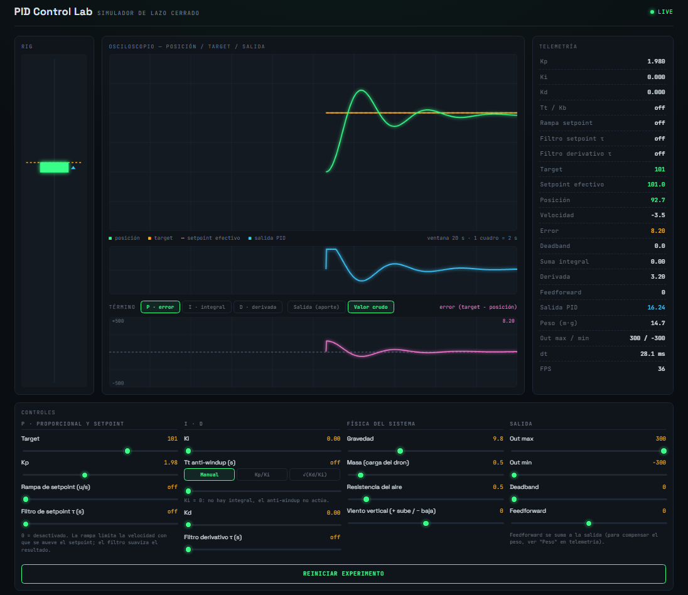

*Solo P, `Kp = 1,98`, `Ki = 0`, `Kd = 0`, sin rampa ni filtro. La salida arranca con un salto brusco y la posición oscila alrededor del objetivo antes de estabilizarse .*

### 5.1 Rampa

**En términos simples:** la rampa limita la **velocidad máxima a la que se mueve el objetivo**, en unidades por segundo (`rate`). En vez de saltar de 70 a 101, el setpoint "camina" hacia 101 a, por ejemplo, 30 unidades por segundo.

**En la curva del error:** el escalón se convierte en una subida gradual. El error arranca desde donde está y crece de a poco, así que `Kp·error` nunca pega el golpe.

**En la matemática:** el setpoint efectivo pasa de ser un escalón a ser una recta de pendiente `rate` que se detiene al llegar al objetivo:

$$r_{ef}(t) = \min\big(T,\; r_0 + \text{rate}\cdot t\big)\quad(\text{para una subida})$$

En el código, la rampa no guarda el setpoint sino su **distancia al objetivo** (`ramp_offset`), y en cada ciclo la acerca a 0 como máximo `rate·dt`:

```c
if (pid->rate > 0.0f)
{
    float step = pid->rate * delta_time;

    if (pid->ramp_offset > step)        pid->ramp_offset -= step;
    else if (pid->ramp_offset < -step)  pid->ramp_offset += step;
    else                                pid->ramp_offset = 0.0f;   // llegó
}
else
{
    pid->ramp_offset = 0.0f;   // rate = 0: sin rampa
}
```

Como el paso depende de `delta_time`, la velocidad de la rampa es la misma aunque cambie la frecuencia del ciclo.

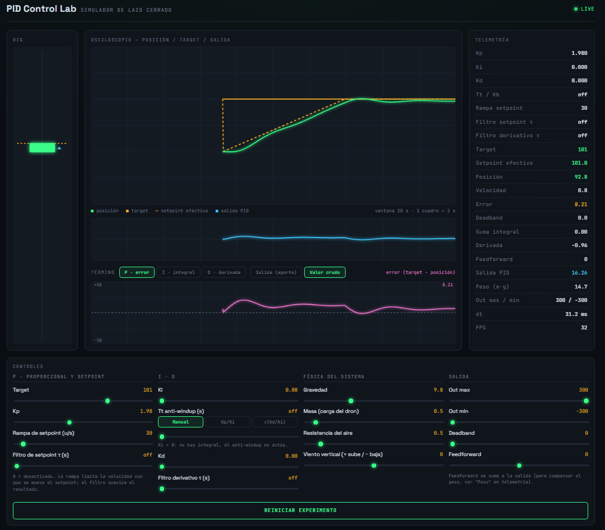

*Rampa de 30 u/s, sin filtro. La línea punteada es el setpoint efectivo: sube en recta hasta el objetivo. La salida deja de dar el golpe inicial y la posición lo sigue sin el sobreimpulso fuerte de la captura anterior.*

### 5.2 Pasa-bajos del objetivo

**En términos simples:** es un filtro de primer orden (como un RC) que **redondea las esquinas** del setpoint. En lugar de moverse con un quiebre, el objetivo se acerca de forma suave y se va frenando al llegar. Su constante de tiempo `tf_filter` (en segundos) dice cuánto tarda: cuanto mayor, más lento y suave.


**En la curva del error:** el error arranca sin salto y su pendiente es máxima al inicio, luego se aplana suavemente hacia el final. El filtro redondea la llegada.

**En la matemática:** es la discretización de `τ·dr/dt = T − r`, cuya respuesta a un escalón es una exponencial:

$$r_{ef}(t) = T - (T - r_0)\,e^{-t/\tau}$$

En el código es el mismo patrón de siempre, "me acerco una fracción `a` a donde quiero estar", aplicado al offset:

```c
if (pid->tf_filter > 0.0f)
{
    float a = delta_time / (pid->tf_filter + delta_time);
    pid->filt_offset += a * (pid->ramp_offset - pid->filt_offset);
}
else
{
    pid->filt_offset = pid->ramp_offset;   // tf_filter = 0: sin filtro
}
```

El coeficiente `a` se calcula con `dt`, así que el filtro se comporta igual aunque cambie la velocidad del ciclo. El denominador `tf_filter + dt` es siempre positivo, por lo que no hay división por cero.

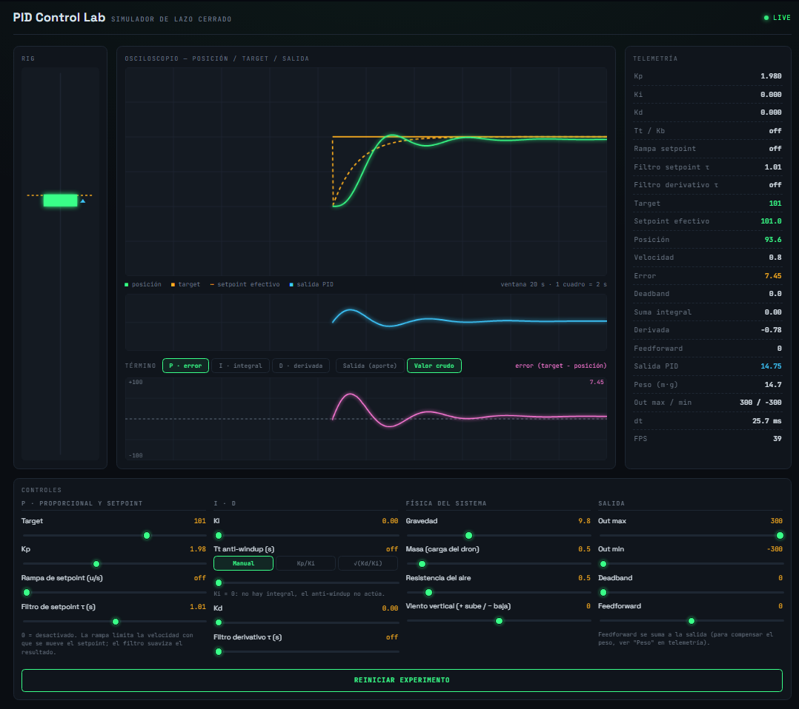

*Filtro del setpoint `τ = 1,01 s`, sin rampa. El setpoint efectivo (punteado) se acerca de forma exponencial al objetivo. El sobreimpulso baja respecto del caso sin mejoras.*

### 5.3 Rampa y pasa-bajos juntos

Están en **serie**: el pasa-bajos filtra la salida de la rampa (por eso `filt_offset` se calcula después de `ramp_offset`).

- La **rampa** impone la velocidad máxima del setpoint, pero tiene dos esquinas: el arranque y la llegada.
- El **pasa-bajos** redondea esas dos esquinas.

El resultado es una curva en **S**: arranca despacio, acelera hasta una velocidad que nunca supera `rate`, y frena suavemente al llegar. Es lo más suave que da esta combinación, a costa de un setpoint efectivo que llega un poco más tarde.

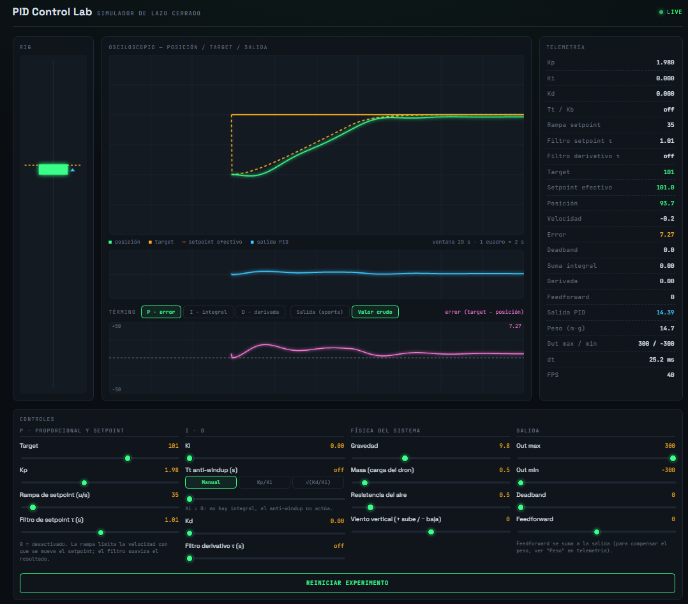

*Rampa de 35 u/s y filtro `τ = 1,01 s`. El setpoint efectivo (punteado) tiene forma de S y la posición lo sigue sin sobreimpulso visible. El error estacionario sigue ahí porque es un P puro.*

**El error que ven P, I y la zona muerta ya incluye el offset:**

```c
float error = (float)(pid->target - current_position) + pid->filt_offset;
```

Esto quiere decir que la integral acumula el error "suavizado". Eso también ayuda al anti-windup, porque acumula menos durante los cambios grandes de objetivo. La **derivada no usa este error**: trabaja sobre la posición (sección 6).

### 5.4 Cómo guardo el offset en float y no el objetivo completo

Los offsets (`ramp_offset`, `filt_offset`) guardan solo la **diferencia** entre el setpoint efectivo y el objetivo. El `target` sigue siendo `int32_t`.

```c
float error = (float)(pid->target - current_position) + pid->filt_offset;
```

La resta `target - current_position` se hace **en enteros**, donde es exacta, y recién después se convierte a `float`, intentando evitar perder precisión con coordenadas grandes al convertir a float únicamente la diferencia.

Esto importa porque un `float` tiene 24 bits de mantisa: representa enteros exactos solo hasta 16 777 216. Si guardara el setpoint absoluto en `float` y trabajara con posiciones grandes, perdería resolución. Con las diferencias, los números son mas chicos y mantienen toda la precisión sin importar qué tan grande sea el valor absoluto.

**¿Y si cambia el objetivo en pleno movimiento?** `PID_SetTarget` desplaza ambos offsets por la diferencia entre el objetivo viejo y el nuevo:

```c
void PID_SetTarget(PIDController *pid, int32_t new_target)
{
    float shift = (float)(pid->target - new_target);
    pid->ramp_offset += shift;
    pid->filt_offset += shift;
    pid->target = new_target;
}
```

Como el setpoint efectivo es `target + offset`, sumar `old − new` al offset lo deja **exactamente en el mismo lugar**. La rampa y el filtro siguen desde donde estaban hacia el nuevo objetivo, sin saltos. El mismo mecanismo se usa en el primer ciclo: `ramp_offset = posición − target`, de modo que el setpoint efectivo arranca en la posición actual.

---

## 6. Término derivativo: corrección de errores

En el término D que lo que hice **no es tanto una "mejora" sino una mas como una corrección de errores**. La versión anterior tenía dos fallas de diseño, y las dos se corrigieron.

**Variables que cambian o se agregan acá:** `previous_position` reemplaza a `previous_error` (ahora guardo la posición del ciclo anterior), y `k_deriv_filter` pasa a ser una constante de tiempo en segundos. `derivative` sigue guardando el valor ya filtrado y sin multiplicar por `Kd`.

### 6.1 Primer Error: derivaba el error, no la posición

Antes:

```c
float raw_derivative = (raw_error - pid->previous_error) / delta_time;
```

Con el objetivo fijo, la derivada del error equivale a la velocidad con signo cambiado, y todo funciona bien. Pero si el **objetivo cambia de golpe**, el error salta en una sola muestra y la derivada interpreta que "nos movimos muchísimo de golpe", cuando el sistema no se movió nada. Eso genera un pico (*derivative kick*) en la salida.

Un ejemplo con números: objetivo de 100 a 150, `dt = 0,02 s`, `Kd = 0,5`. El error salta 50 en un ciclo:

- derivada del error: `50 / 0,02 = 2500`
- aporte de D: `0,5 × 2500 = 1250` unidades de salida, por un ciclo (sin contar el filtro)

Eso satura la salida entera para un movimiento que ni siquiera ocurrió.

Ahora:

```c
float raw_derivative = (pid->previous_position - current_position) / delta_time;
```

Se deriva la **posición**, que es lo que realmente se mueve. Cambiar el objetivo no modifica la posición, así que no hay pico. El signo sigue igual que antes (`previous − current` equivale a la derivada del error con objetivo fijo), por lo que el término D sigue oponiéndose al movimiento. En la telemetría se ve negativo mientras el dron sube.

Esto es consistente con el resto del diseño: la derivada tampoco ve la rampa, el filtro ni la zona muerta, así que nunca ve un salto artificial. Y el flag `initialized` evita el otro pico: haciendo `pid->previous_position = current_position;` ya que si esta en 0 por default y el `current_position` no empieza en 0 generaria un pico.

### 6.2 Error 2: el filtro dependía de la frecuencia del ciclo

Antes, el filtro usaba un coeficiente **fijo** por ciclo:

```c
pid->derivative = (k * raw_derivative) + ((1.0f - k) * pid->derivative);
```

Un coeficiente por ciclo significa que el filtro avanza *una cantidad fija por llamada*, no por segundo. Entonces su comportamiento depende de qué tan seguido se llame. Lo mismo, con ciclos más lentos, filtra mucho más.

Ahora el coeficiente se calcula con el tiempo real:

```c
float alpha = delta_time / (pid->k_deriv_filter + delta_time);
pid->derivative = (alpha * raw_derivative) + ((1.0f - alpha) * pid->derivative);
```

`k_deriv_filter` pasó a ser una constante de tiempo en segundos, y `alpha` se adapta a `dt`. Como `alpha` se calcula con `delta_time + k_deriv_filter` en el denominador, con `k_deriv_filter = 0` da exactamente `alpha = 1`: sin filtro, sin necesidad de un `if` para ese caso.

**Ejemplo con números.** Supongo que la velocidad real es constante y vale `10`, y que el filtro parte de `0`. Miro cuánto vale la derivada filtrada después de **1 segundo**:

| | `dt = 0,5 s` (2 ciclos) | `dt = 0,1 s` (10 ciclos) |
|---|---|---|
| **Antes**, `k = 0,2` fijo | `0,2·10 + 0,8·2 = ` **3,60** | `10·(1 − 0,8¹⁰) = ` **8,93** |
| **Ahora**, `τ = 0,4 s` (`alpha` = 0,556 y 0,2) | **8,03** | **8,93** |
| Valor "real" de la curva continua | 9,18 | 9,18 |

(Elegí `k = 0,2` y `τ = 0,4 s` porque coinciden a `dt = 0,1 s`: `alpha = 0,1 / (0,4 + 0,1) = 0,2`.)

Con el código anterior, el mismo filtro daba `3,60` o `8,93` después de un segundo según la velocidad de actualización: una diferencia enorme para algo que debería depender solo del tiempo. Con el nuevo, la diferencia entre `8,03` y `8,93` es mucho más chica, y ambos valores se acercan a `9,18`. **La diferencia que queda es la propia de la discretización:** cuantos más ciclos entran en el mismo tiempo (`dt` más chico), más se acerca la versión discreta a la curva real. Esto no se puede eliminar con un filtro de este tipo, pero sí mantener acotado.

### 6.3 Resultado en la simulación

Para ver el ruido uso `Kd = 2,02` con la derivada sin filtro, y luego con filtro `τ = 0,48 s`. (`Ki = 0`, por lo que el `Tt` de la interfaz no influye: la telemetría muestra `Tt / Kb: off`.)

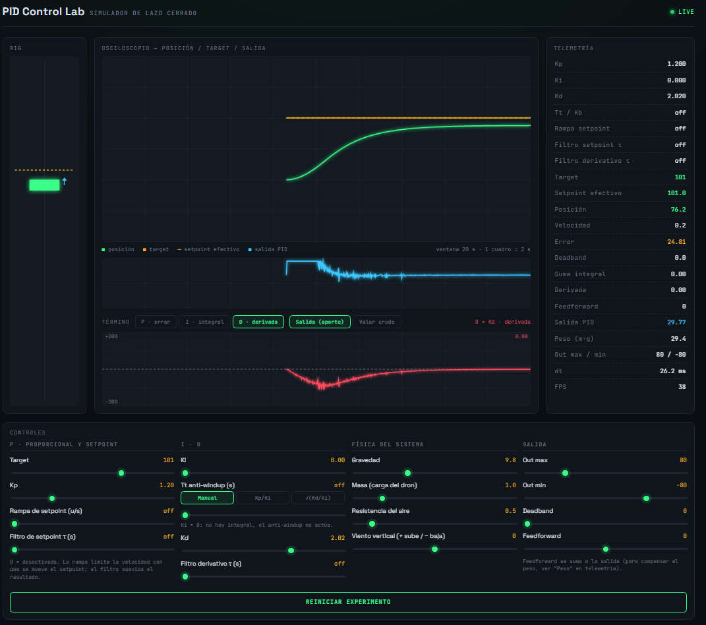

*Sin filtro en la derivada: la salida tiene mucho ruido. Me parece que viene de la cuantización de la posición (que llega como entero) y de la variación de `dt`, que la derivada amplifica.*

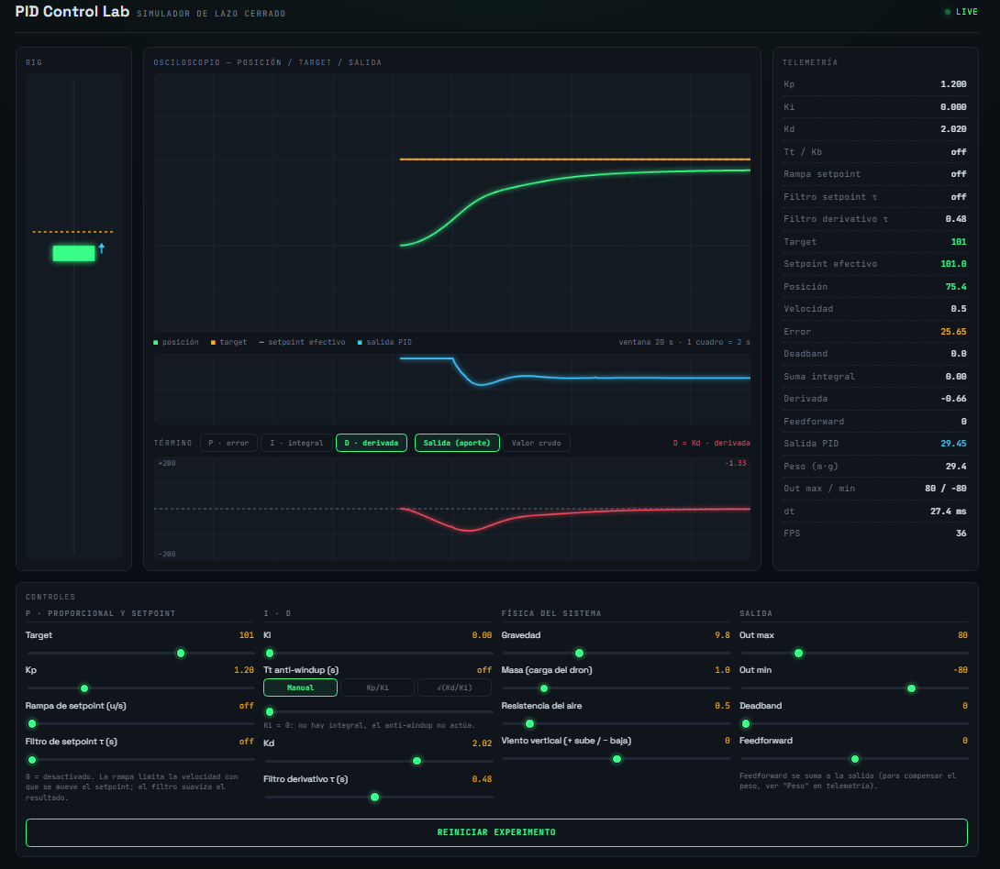

*Con filtro `τ = 0,48 s`: la misma situación, pero con la salida suave.*


### Una aclaración (Desde el futuro) sobre el ruido de la derivada

Si bien el ruido de la derivada sin filtro me sirvió para mostrar el funcionamiento del filtro, ese comportamiento me hizo ruido: el sensor del simulador es perfecto y no esperaba una señal tan sucia. Me puse a buscar y resultó ser un **problema del simulador, no del controlador**.

**Qué pasaba.** El lazo del simulador (`loop()` en `index.html`) hacía esto en cada cuadro, en este orden:

```js
let dt = (now - lastTime) / 1000.0;          // 1) dt entre cuadros

fetch('/compute', { body: JSON.stringify({   // 2) manda posición y dt al PID
    position: Math.round(position * FIX), dt, feedforward: ... }) });

for (let i = 0; i < steps; i++) { ... }      // 3) recién ahora avanza la física con ese mismo dt
```

La posición que se manda en el paso 2 es el resultado de la física que se integró en la vuelta anterior, con el `dt` **anterior**. Pero el `dt` que se manda junto con ella es el **actual**. Entonces la derivada calculaba el desplazamiento de un intervalo dividido por el `dt` de otro intervalo, y la velocidad estimada quedaba multiplicada por `dt_anterior / dt_actual`.

Un ejemplo con números: el dron va a 100 u/s y en el intervalo anterior (25 ms) se movió 2,5 unidades. El `dt` entre cuadros varía; en la telemetría de mis capturas aparecen valores entre 22 y 31 ms.

| `dt` actual que recibe el PID | Velocidad que calcula la derivada | Error |
|---|---|---|
| 22 ms | 2,5 / 0,022 ≈ **114** | +14 % |
| 25 ms | 2,5 / 0,025 = **100** | 0 % |
| 31 ms | 2,5 / 0,031 ≈ **81** | −19 % |

La velocidad real es la misma en las tres filas, pero la derivada "ve" valores distintos según el cuadro que le toque. En el pico de la captura, la derivada ronda las 100 unidades de salida, así que un error de ±15 a 20 % da un ruido de ese orden, que es justamente lo que se ve.

Esto explica por qué el ruido es **proporcional a la señal**: crece en el pico de la derivada, donde la velocidad es alta, y casi desaparece al final, donde la velocidad es baja. Un ruido de cuantización tendría amplitud constante. De hecho, la cuantización ya estaba resuelta en el simulador: manda la posición multiplicada por `FIX = 100` (resolución de 0,01) y divide las ganancias por `FIX`. Con `Kd = 2,02` y `dt ≈ 25 ms`, un salto de una cuenta mueve la derivada unas 0,8 unidades de salida, muy lejos del ruido de la captura.

**Comprobación.** Reproduje el lazo del simulador aparte (mismo modelo físico, `FIX`, ganancias, límites y un `dt` entre 22 y 31 ms) y comparé las dos formas de pasar el `dt`:

| `dt` que se le manda al PID | Ruido de la derivada (desvío estándar) |
|---|---|
| El del cuadro actual (como estaba) | ≈ 13 |
| El que se usó para mover la posición | ≈ 0,3 |

Con el `dt` correcto el ruido baja unas 40 veces y queda al nivel de la cuantización. Además, con el `dt` del cuadro actual el ruido era unas 50 veces mayor cuando la derivada era grande que cuando era chica, como corresponde a un error proporcional a la señal. El filtro de `0,48 s` de la captura siguiente limpiaba la señal, pero en realidad estaba tapando este desfase en vez de resolverlo.

**La solución en el simulador.** Le pedí a Claude que corrigiera este error en el simulador y ahora funciona correctamente. La idea de la corrección es mandarle al PID el `dt` con el que se integró la física en la vuelta anterior, mientras el `dt` actual sigue usándose para avanzar la física:

```js
let physDt = 0.025;   // dt con el que se movió la posición en la vuelta anterior

// al llamar a /compute:
body: JSON.stringify({ position: Math.round(position * FIX), dt: physDt, feedforward: ... })

// al terminar el for de sub-pasos de la física:
physDt = dt;
```

Otra opción es simular con un paso fijo y mandar siempre ese mismo `dt`, que es más limpio pero cambia más código.

Esta es una situación equivalente con la derivada sin filtro, ya con el simulador corregido. Cambió el `Kd` (2,23 en vez de 2,02), así que las amplitudes no son idénticas a las de las capturas anteriores:

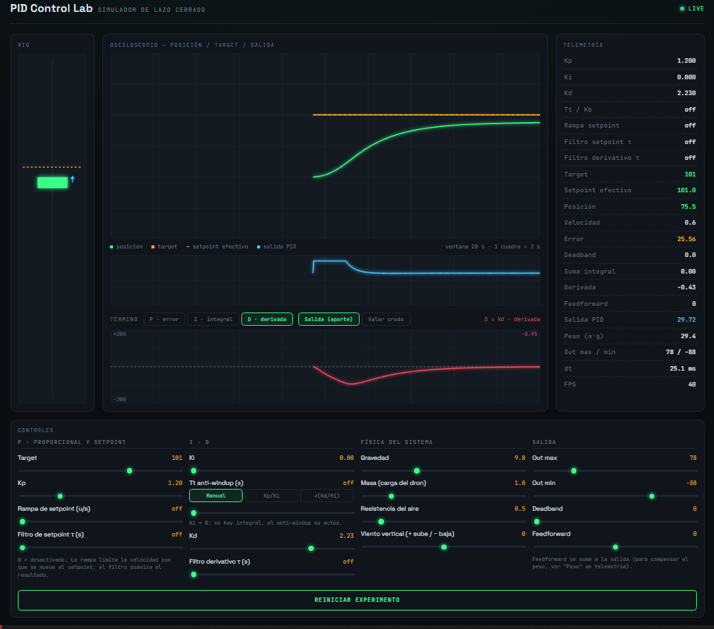

*Derivada sin filtro (`Kd = 2,23`), con el simulador corregido: la salida y el término D ya no tienen ruido. Las dos capturas anteriores de esta sección son de antes de la corrección y usaban `Kd = 2,02`.*

**De todas formas, el error me ayudó a mostrar el filtro de paso bajo.** Gracias a ese ruido pude mostrar con claridad qué hace el filtro.

**El controlador estaba bien.** `PID_Compute` calcula `(previous_position - current_position) / delta_time` correctamente y, con `k_deriv_filter = 0`, `alpha` vale 1 y no filtra. Hace lo que debe con los datos que recibe.

---

## 7. Término integral: anti-windup

**Variables nuevas que usa esta parte:** `Tt` (constante de tiempo del anti-windup, en segundos) y `kb` (`1/Tt`, la calculo yo una sola vez en los setters). `integral` reemplaza a `integral_sum` y ahora ya incluye `Ki`. También intervienen `Feedforward` (parámetro) y los límites `out_min` / `out_max`.

### 7.1 El problema

Cuando la salida **satura** (el actuador no puede dar más), el error sigue existiendo y la integral sigue acumulando, aunque ese empuje extra no se pueda aplicar. Eso es el *windup*. Cuando el sistema por fin llega al objetivo, la integral está llena y hace falta un período de error negativo, es decir de **sobreimpulso**, para descargarla.

La versión anterior solo limitaba la integral al rango de salida:

```c
pid->integral_sum += error * delta_time;
if (pid->ki != 0.0f)
{
    pid->integral_sum = clamp(pid->integral_sum, pid->out_min / pid->ki, pid->out_max / pid->ki);
}
else
{
    pid->integral_sum = 0.0f;
}
...
float output = (pid->kp * error) + (pid->ki * pid->integral_sum) + (pid->kd * pid->derivative);
output = clamp(output, pid->out_min, pid->out_max);
```

Ese límite mira **solo a la integral**: la deja llegar hasta `out_max` aunque P ya haya saturado la salida por su cuenta. La integral queda "pegada" en el tope hasta que el error cambia de signo.

### 7.2 La solución: back-calculation con `Tt`

Ahora la integral recibe un término extra que la **descarga en proporción a cuánto se está pasando la salida**:

```c
float raw_output = (pid->kp * error) + pid->integral + (pid->kd * pid->derivative) + Feedforward;
float output     = clamp(raw_output, pid->out_min, pid->out_max);

pid->integral += (pid->ki * error + pid->kb * (output - raw_output)) * delta_time;
pid->integral  = clamp(pid->integral, pid->out_min - Feedforward, pid->out_max - Feedforward);
```

En términos continuos:

$$\frac{dI}{dt} = K_i\,e + \frac{1}{T_t}\,(u_{sat} - u)$$

- **Sin saturación**, `output == raw_output`, el segundo término vale 0 y la integral es la de siempre.
- **Con saturación**, `output − raw_output` tiene signo contrario al exceso y **resta** a la integral a razón de `kb = 1/Tt`. Cuanto menor es `Tt`, más rápido se descarga.

La integral no se desborda ni se queda pegada en el tope: se mantiene cerca del valor que realmente hace falta.

En la interfaz del simulador, el `Tt` se puede cargar a mano o con atajos (`Kp/Ki` o `√(Kd/Ki)`), que son reglas de ajuste habituales.

### 7.3 Por qué ya no hace falta el `if`

El `if (ki != 0)` de la versión anterior existía por la **división** `out_min / ki`. Sin él, `ki = 0` rompía la cuenta. Ahora:

1. **La integral guarda `Ki·∫e dt`**, no `∫e dt`. Con `Ki = 0`, el término `ki * error` vale 0 y no se acumula nada. Ya no hay ninguna división por `ki`.
2. Como no se divide por `ki`, tampoco aparecen los problemas que traía: con `ki` muy chico los límites se iban a valores enormes, y con `ki` negativo los límites quedaban **invertidos** (`min > max`).
3. **`kb` ya vale 0 cuando `ki == 0`** (lo garantiza `pid_update_kb`). Esto es necesario: si `kb` fuera distinto de cero con `Ki = 0`, el término de descarga mantendría la integral moviéndose sin que nada la haya acumulado. Con `kb = 0` queda quieta.
4. `PID_SetKi(0)` además **borra** la integral para que no quede un valor viejo.

El límite final `clamp(integral, out_min − FF, out_max − FF)` se mantiene como **tope duro**: garantiza que la integral nunca crezca sin control, que es la seguridad numérica que ya tenía la versión anterior.

**Un detalle del orden:** la integral se actualiza *después* de calcular la salida, así que la salida de un ciclo usa la integral acumulada hasta el ciclo anterior. En la versión anterior se actualizaba antes. A cambio, la descarga usa la saturación real de ese mismo ciclo.

### 7.4 Resultado en la simulación

Para aislar el efecto del anti-windup desactivé las mejoras del P (sin rampa ni filtro). Los dos casos usan **la misma configuración**: `Kp = 1,2`, `Ki = 0,8`, `Kd = 0`, salida limitada a ±80 (para que sature fácil) y peso 29,4 (masa 1,0). La **única** diferencia es `Tt`.

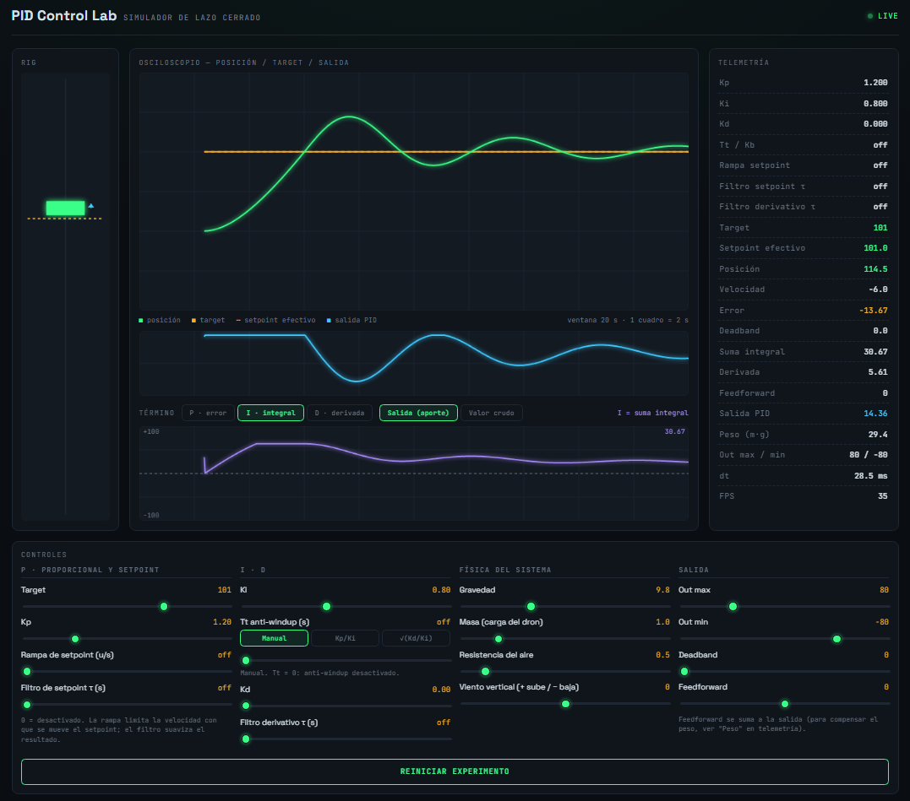

*Sin `Tt`: durante un buen tiempo la integral queda pegada en 80, el máximo permitido por el clamp. Al llegar al objetivo todavía tiene que descargarse, y eso se traduce en un sobreimpulso grande y en oscilaciones más largas.*

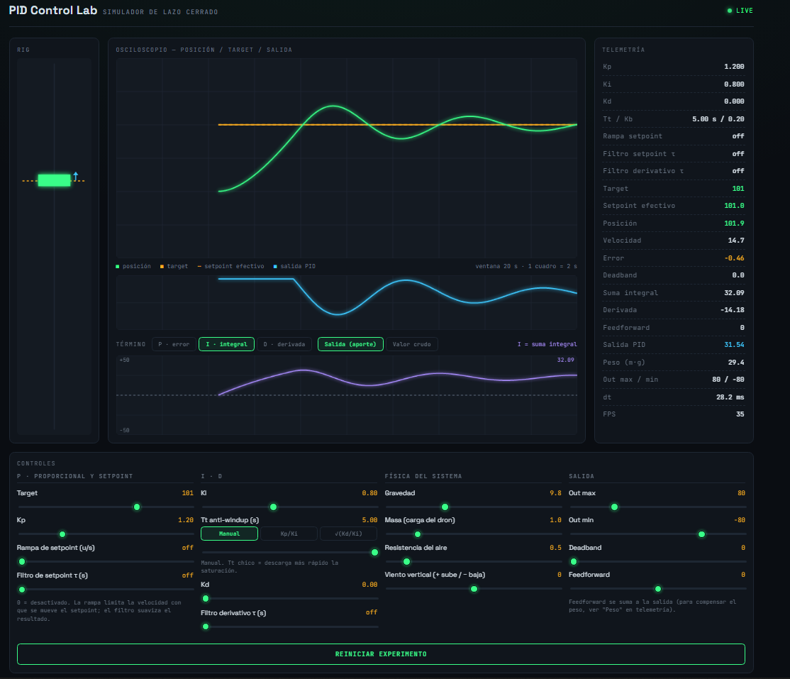

*Con `Tt = 5 s` (`kb = 0,2`): el valor máximo de la integral fue de alrededor de 30. Coincide, aproximadamente, con lo que hace falta para sostener el peso (29,4). El sobreimpulso es claramente menor.*

> **Ojo con la escala:** en las dos capturas el gráfico de la integral tiene escalas distintas (±100 en la primera, ±50 en la segunda), porque cambié el máximo y el mínimo del eje. La diferencia entre un tope en 80 y un máximo en 30 se ve más claramente en los valores que en la altura de la curva.

---

## 8. Costo en RAM

Estas mejoras no son gratis, y se pagan con RAM, tanto en el `struct` como en la pila de `PID_Compute`.

**En el `struct` (por instancia):**

| Campo nuevo | Tamaño |
|---|---|
| `Tt` | 4 B |
| `kb` | 4 B |
| `rate` | 4 B |
| `tf_filter` | 4 B |
| `ramp_offset` | 4 B |
| `filt_offset` | 4 B |
| `initialized` | 1 B (+ 3 B de *padding*) |

Pasa de **44 bytes** a **72 bytes** (28 más) en una plataforma de 32 bits. El *padding* aparece porque `initialized` es un `unsigned char` seguido de un `float` que necesita alineación de 4 bytes. Conviene verificar el tamaño exacto con `sizeof(PIDController)` en el compilador y la plataforma de cada proyecto.

**En la pila de `PID_Compute`:** la versión anterior usaba 4 variables locales (`raw_error`, `error`, `raw_derivative`, `output`). Ahora son 7 (`step`, `a`, `error`, `raw_derivative`, `alpha`, `raw_output`, `output`). Varias viven en bloques excluyentes y el compilador puede reutilizar registros, así que en la práctica el costo es menor que el máximo teórico.

**En CPU:** hay más cuentas por ciclo. En el peor caso siguen siendo 3 divisiones por llamada, las mismas que antes (la derivada, `alpha` y `a`; antes eran la derivada y los dos límites `out/ki`). Igual que en la versión anterior, en microcontroladores sin FPU las operaciones `float` se emulan por software, así que conviene medir el tiempo de ejecución en el hardware real.

Como cada instancia es independiente (sin estado global), se pueden tener varios PID, uno por eje o por motor, al costo de esos 72 bytes cada uno.

---

## 9. Uso básico

```c
#include "pid.h"

PIDController pid;

// kp, ki, kd, Tt, rate, tf_filter, k_deriv_filter, out_max, out_min, deadband
PID_Init(&pid, 1.2f, 0.8f, 0.0f, 5.0f, 0.0f, 0.0f, 0.0f, 80.0f, -80.0f, 0.0f);
PID_SetTarget(&pid, 101);

// En cada ciclo de control:
float salida = PID_Compute(&pid, posicion_medida, dt, feedforward);
// Si no necesito feedforward: PID_Compute(&pid, posicion_medida, dt, 0.0f);

// Ajustes en vivo, uno por uno:
PID_SetRate(&pid, 30.0f);          // activa la rampa
PID_SetTfFilter(&pid, 1.0f);       // activa el filtro del objetivo
PID_SetDerivFilter(&pid, 0.48f);   // filtro de la derivada (segundos)
PID_SetTt(&pid, 5.0f);             // anti-windup

// O todo junto:
PID_SetGains(&pid, 1.2f, 0.8f, 2.0f, 5.0f, 30.0f, 1.0f, 0.48f);
```

---

## 10. Diferencias con el simulador anterior

> **Aclaración importante:** los cambios del simulador los generé con IA (Claude). El simulador **no es parte del controlador** y su única función es mostrar cómo funciona el PID. La salida de control la calcula siempre el código en C de este repositorio, y el simulador solo implementa el "mundo" (física del dron) y los gráficos. El simulador original lo describo en el informe del [repositorio anterior](https://github.com/HernandezMatiasDev/PID).

Al sumar las mejoras del controlador, el simulador también tuvo que cambiar: necesitaba controles nuevos para probarlas y una forma de ver qué aporta cada término.

### 10.1 Controles: nuevos campos y mejor ordenados

Antes los controles estaban en tres paneles: *Ganancias PID*, *Física del sistema* y *Límites de salida*.

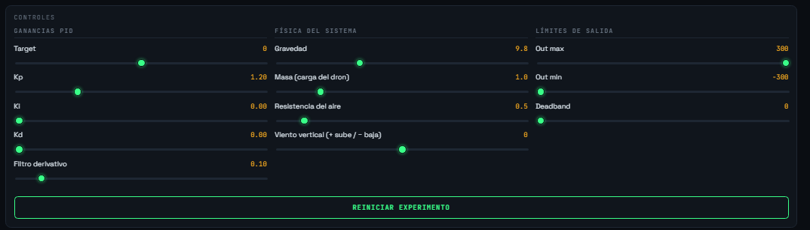

*Simulador anterior: Target, Kp, Ki, Kd y un único "Filtro derivativo".*

Ahora los controles están agrupados **según el término del PID al que afectan**, que es el mismo orden en que explico las mejoras en este README:

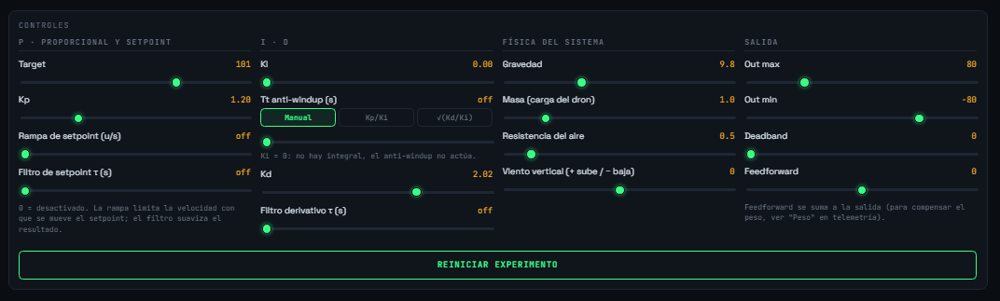

*Simulador actual: cuatro paneles (P y setpoint, I y D, Física del sistema, Salida).*

| | Simulador anterior | Simulador actual |
|---|---|---|
| **Paneles** | Ganancias PID · Física del sistema · Límites de salida | P · Proporcional y setpoint · I · D · Física del sistema · Salida |
| **Parámetros del P** | Target, Kp | Target, Kp, **Rampa de setpoint (u/s)**, **Filtro de setpoint τ (s)** |
| **Parámetros de I y D** | Ki, Kd, Filtro derivativo | Ki, **Tt anti-windup (s)**, Kd, **Filtro derivativo τ (s)** |
| **Tt** | No existía | Se carga a mano (**Manual**) o con los atajos **Kp/Ki** y **√(Kd/Ki)** |
| **Filtro derivativo** | Coeficiente (en el informe, `1` = sin filtro) | Constante de tiempo en segundos, `off` = 0 |
| **Salida** | Out max, Out min, Deadband | Out max, Out min, Deadband, **Feedforward** |
| **Ayudas** | Sin textos de ayuda | Una línea bajo cada control (por ejemplo, "0 = desactivado" o "Ki = 0: no hay integral, el anti-windup no actúa") |

Los controles nuevos se corresponden con los parámetros nuevos del controlador: `rate`, `tf_filter`, `Tt`, `k_deriv_filter` (que ahora es un tiempo) y el `Feedforward` que se pasa a `PID_Compute`. Los que están en `off` son los que valen 0, es decir, los que dejan de tener efecto (sección 3).

### 10.2 Telemetría y osciloscopio

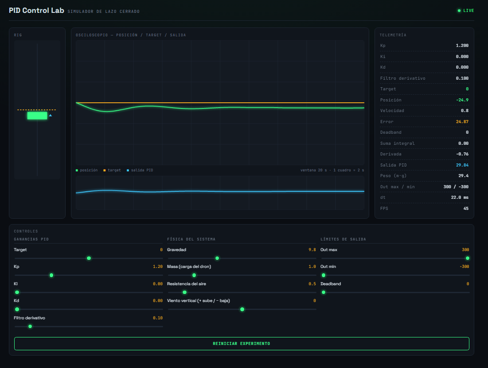

*Simulador anterior: un osciloscopio con posición, target y salida del PID, y un panel de telemetría.*

- **Telemetría nueva:** `Tt / Kb`, `Rampa setpoint`, `Filtro setpoint τ`, `Filtro derivativo τ` (antes solo "Filtro derivativo"), `Setpoint efectivo` y `Feedforward`.
- **Setpoint efectivo:** el osciloscopio ahora dibuja una línea punteada con el setpoint que realmente ve el término P (el objetivo después de la rampa y del filtro). Es la curva de las capturas de la sección 5.
- **Suma integral:** ahora muestra directamente el valor de `integral`, que ya incluye `Ki` (sección 1.4).

### 10.3 Gráfico de salida de cada término

Lo más importante que se agregó es un **tercer gráfico** debajo del osciloscopio. Con tres botones elijo qué término mostrar (**P · error**, **I · integral**, **D · derivada**) y con otro par de botones elijo cómo verlo:

- **Valor crudo:** la señal del término antes de multiplicarla por su ganancia (por ejemplo, el error del P o la derivada del D).
- **Salida (aporte):** lo que ese término suma realmente a la salida del PID (por ejemplo, `D = Kd · derivada`).

El gráfico muestra el valor actual arriba a la derecha y tiene su propia escala vertical (por eso las capturas de la sección 7 tienen ejes distintos).

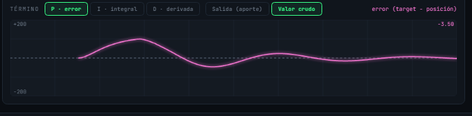

*P en valor crudo: el error `target − posición` a lo largo del tiempo.*

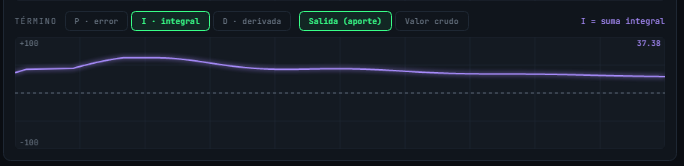

*I en aporte: la suma integral. En este término, valor crudo y aporte son lo mismo, porque la integral ya se guarda multiplicada por `Ki`.*

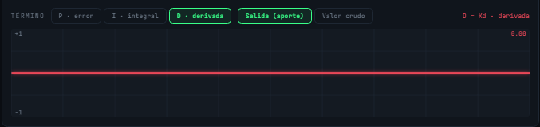

*D en aporte: `Kd · derivada`. Con el dron quieto vale 0.*

Este gráfico me sirvió para armar las comparaciones de este README, por ejemplo para ver la integral pegada en el tope sin `Tt` (sección 7.4) o el ruido de la derivada sin filtro (sección 6.3).

---

## 11. Notas y limitaciones

- **Concurrencia.** los setters escriben campos del `struct` sin protección, así que si se llaman desde otra tarea o interrupción mientras `PID_Compute` corre, puede haber una condición de carrera. `PID_SetTarget` es el más delicado porque toca tres campos. Aun así, **limitar el acceso a los recursos es responsabilidad de quien implementa la librería**, no de la librería. No me pareció práctico ni óptimo meter semáforos, mutex o algo parecido dentro del controlador. Quien la use sabe en qué plataforma corre y cómo se reparten las tareas, y puede proteger el acceso.
- **`delta_time`.** `PID_Compute` no mide el tiempo ni valida el `delta_time` que recibe. Decidí no calcularlo adentro para que el código se mantenga 100 % limpio y no dependa de nada externo (relojes, timers, plataforma). Por la misma razón, **pasar el `dt` correcto es tarea de quien implementa la librería**: tiene que ser el tiempo real entre las lecturas de posición (Como en la sección 6.3, donde un `dt` mal pasado generaba ruido). Tampoco agregué validación para un `dt` negativo, porque no considero que tenga sentido que transcurra un tiempo negativo: si llega uno, es un error de quien llama.
- **Un `dt` constante simplifica todo.** Los filtros se adaptan a `dt`, pero en un microcontrolador lo ideal es ejecutar el PID desde un temporizador a frecuencia fija.
- **Ganancias en la interfaz.** Los valores de `Ki` que muestro en las capturas son los del control del simulador, que puede aplicar un factor de escala antes de enviarlos al controlador (ver el informe del repositorio anterior).
